# The Pantheon, c. 126 AD

A reconstruction of Hadrian's Pantheon in Rome as it may have looked when new, built at its measured
dimensions and rendered in Unreal Engine 5. It is a walk-through app for macOS, and films recorded
from the engine. The interior has its original flat attic, coloured marbles, painted altars, a statue
in every niche and a dome painted as the night sky. Outside, the portico stands on its podium over a
travertine forecourt between colonnades, the drum rises to its full height, and the dome is covered in
gilded bronze tiles. The city of the Campus Martius stands round it.

Where the evidence runs out, the choices are marked as reconstructions in the notes under
[`reference/`](reference/). Those notes hold the dimensions with their sources, the stones, the lost
finishes, the attic and the polychromy.

## Screenshots

All taken in the engine (`ue/shots/readme.txt`, with the walk-through's `-PantheonShots` mode).

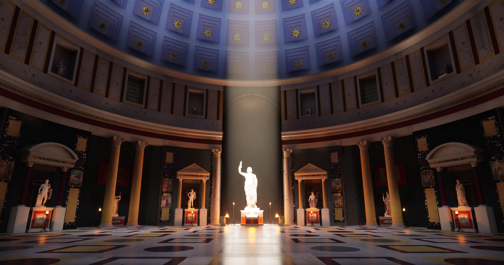
**The rotunda.** The light from the oculus falls on Jupiter in the apse; the aediculae and the exedrae with
their column screens run all round under the original flat attic and the coffered dome.

| | |
|---|---|
| 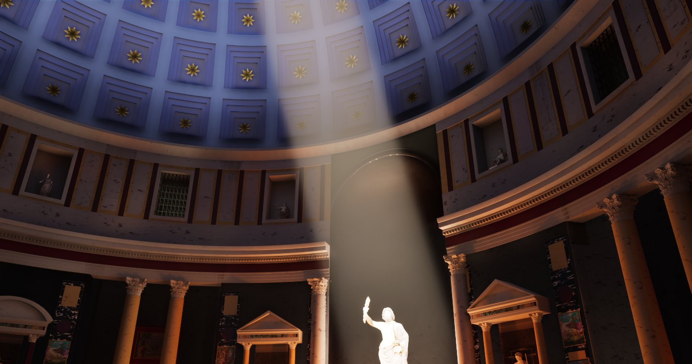 | 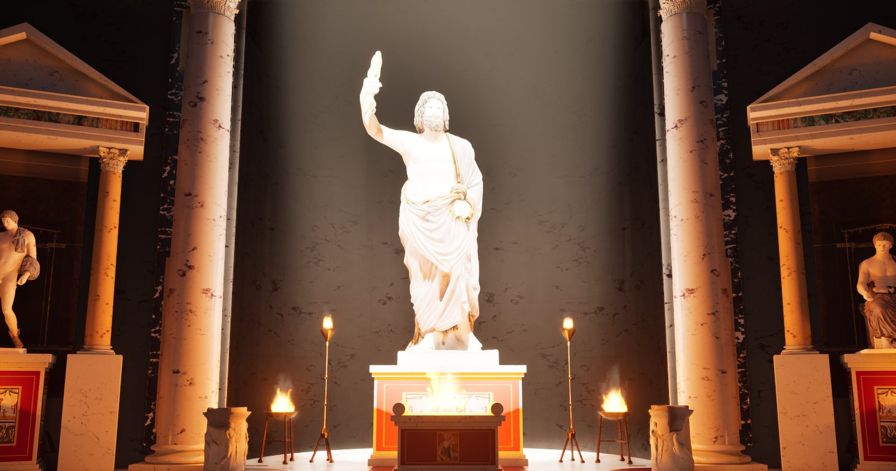 |
| **The light shaft** from the oculus, crossing the dome | **Jupiter** in the apse, the altar fire and candelabra before him |
| 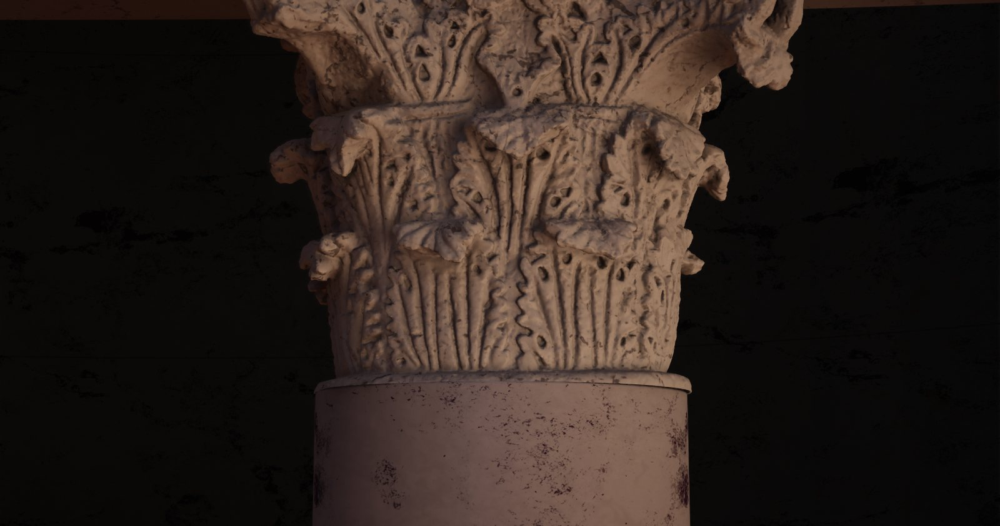 | 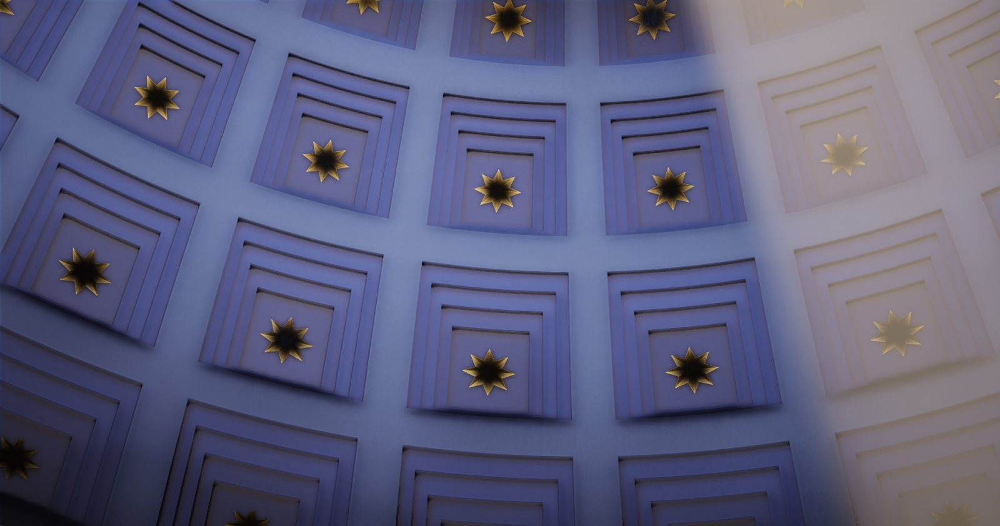 |
| **A Corinthian capital** of an exedra's column screen, from a scan | **The coffers**, painted as the night sky with gilded rosettes for stars |
| 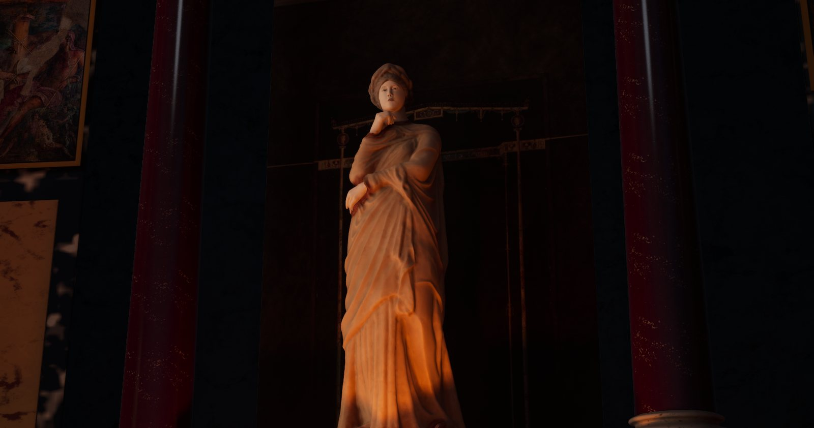 | 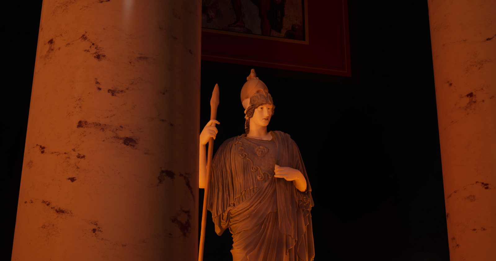 |
| **Ceres** in her aedicula between porphyry columns | **Minerva** behind the columns of her exedra, a painting above |
| 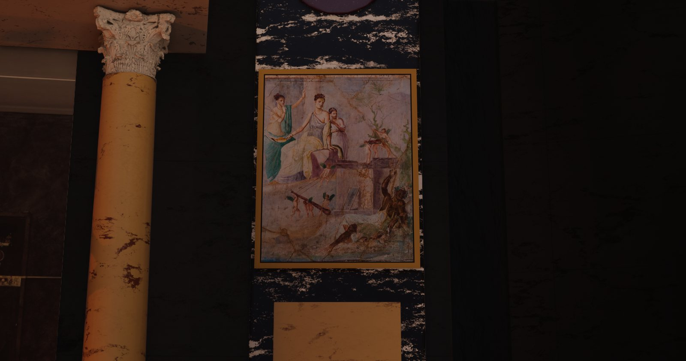 | 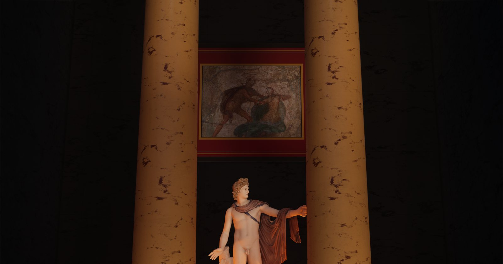 |
| **A painted panel** on a pier beside an aedicula | **A diagonal exedra**: giallo antico columns, a painted field over the statue |
| 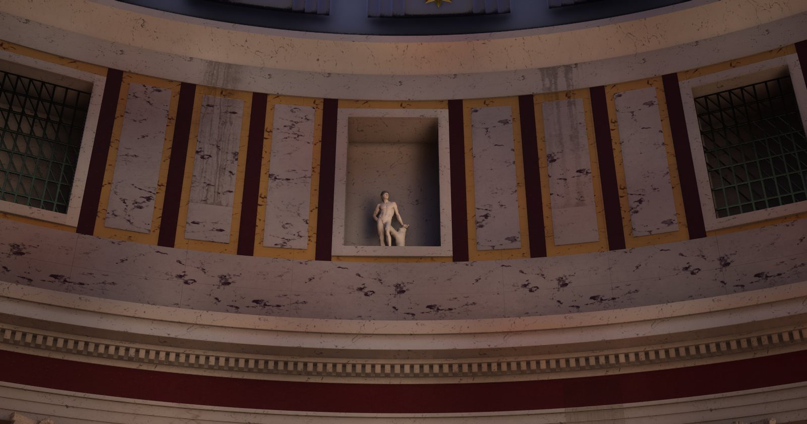 | 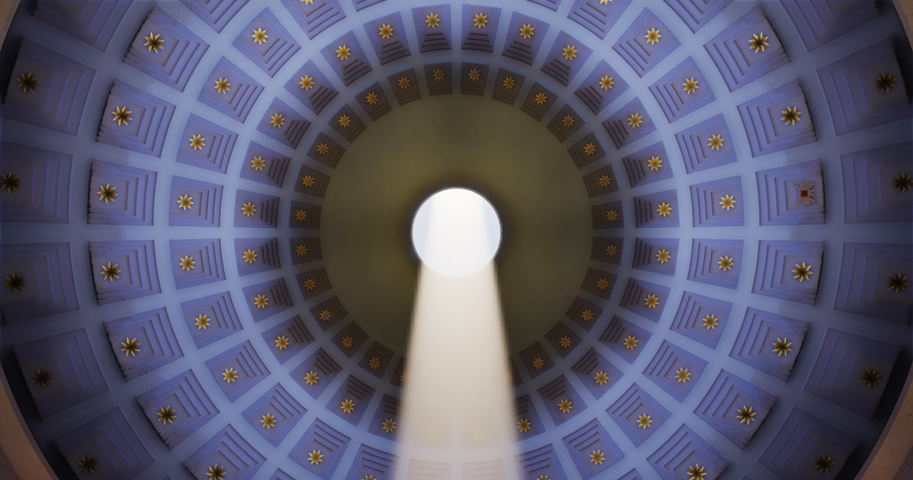 |
| **The attic** as it was before 1747: porphyry pilasters, marble panels, grilled windows and a niche | **The oculus** and the shaft of light, straight up |
| 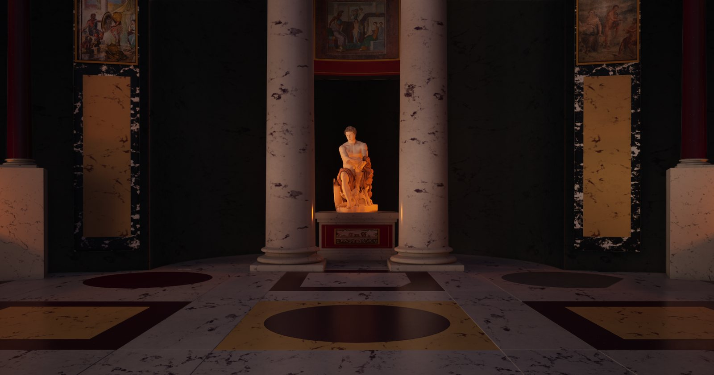 | 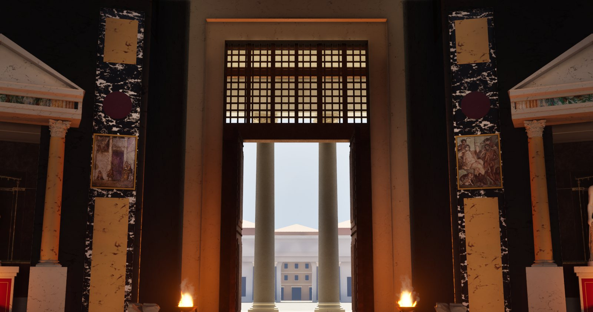 |
| **An exedra** across the patterned floor | **The bronze doors** from inside, the portico and the forecourt beyond |

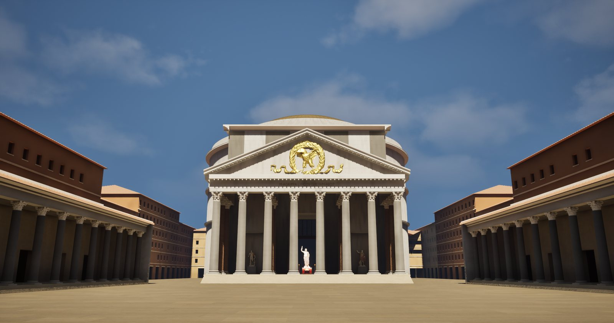
**Outside:** the portico on its podium, with the gilded eagle on its pediment, over the forecourt between
the colonnades, and the city round it.

There are also a few easter eggs to find.

## The walk-through app

A Shipping build for macOS (Apple silicon, Metal SM6) made from `ue/Pantheon`. It starts on the
forecourt, looking in through the doors.

| Keys | |
|---|---|
| W A S D, arrows, mouse | walk and look |
| Shift | walk briskly |
| F | fly; Q, E or Space, C move up and down |
| Tab | the next viewpoint (forecourt, portico, doors, oculus, statues, attic, dome) |
| `-` `=`, mouse wheel | zoom |
| `[` `]` | exposure |
| 1, 2, 3 | quality |
| G | ghosts of Romans at prayer, in plain Roman dress |
| R | back to the start |
| H, F1 | help |
| Esc | quit |

## How it is built

| Step | Tool | Where |
|---|---|---|
| Architecture: drum, recesses, aediculae, attic, coffered dome, portico, forecourt, city | Blender, Python | `blender/build_pantheon.py` (`--export assets/architecture/fbx`; `--only Name1,Name2` for single objects) |
| Statues: museum scans, cleaned, painted | Blender | `blender/process_statues.py`, `blender/paint_statues.py`; sources in `assets/statues/manifest.md` |
| Materials, import, collision, the level | Unreal Engine 5.9, Python | `ue/scripts/build_scene.py` (`PANTHEON_STEPS=textures,materials,import,collision,level`), `ue/scripts/pantheon_materials.py` |
| The walk-through, ghosts, films from the game | C++ | `ue/Pantheon/Source/Pantheon` |
| Films with Movie Render Queue | Sequencer, Python | `ue/scripts/sequence.py`, `ue/render.sh`, `ue/encode.sh` |
| The pediment's eagle | Depth Anything V2 (local), TRELLIS.2 | `tools/eagle_relief.py`, `tools/eagle_trellis.py` |

Large and downloaded files (scans, textures, FBX exports, the Unreal content, renders) are not in the
repository: the scripts and manifests rebuild or fetch them. The project was made on an Apple M5 Pro
with Unreal Engine 5.9.0, Blender 5.3 and Xcode 27.2.

Packaging the app: `tools/package_mac.sh [version]` makes a Shipping build, strips its symbols, adds the
credits, signs it ad hoc and writes `dist/Pantheon.app` (about 1.0 GB) and `dist/Pantheon-<version>-mac.dmg`
(about 0.8 GB). For the app, world textures are capped at 2048 px (`ue/Pantheon/Config/DefaultDeviceProfiles.ini`);
the editor and the films keep them whole. The app is not notarised, so on first launch macOS asks for
"Open Anyway" in System Settings > Privacy & Security.

## Sources and credits

- **Dimensions and history:** Desgodetz (1682), Francesco Piranesi (1790), De Fine Licht, Marder and
  Wilson Jones (eds., 2015), Martines, Moore and others; see `reference/dimensions.md` and
  `reference/sources.md`.
- **Statues:** museum scans and open models, listed with their licences in `assets/statues/manifest.md`.
  Some are CC BY-NC-SA, so the project as a whole is for non-commercial use.
- **Stone, metal and plaster textures:** ambientCG (CC0); scanned surfaces and decals from Quixel
  Megascans through Fab, used under Fab's licence and not included here.
- **Fire:** JangaFX's free fire simulations (CC0), rendered to flipbooks in Blender.
- **The pediment's eagle:** modelled from a photo of the Trajanic eagle relief at Santi Apostoli, Rome,
  by Sailko, [CC BY 3.0](https://creativecommons.org/licenses/by/3.0/), via Wikimedia Commons
  (`assets/eagle/photos/SOURCES.md`). Modelled with TRELLIS.2 (Microsoft) and Depth Anything V2.
- **Clouds:** Unreal Engine's own volumetric cloud material.
- **Paintings:** see `assets/paintings/sources.md`.

## Licence

- **Code** (`blender/`, `tools/`, `ue/scripts/`, `ue/Pantheon/Source/`, the project's configuration and the
  shell scripts): [MIT](LICENSE).
- **Everything else** (the screenshots, this README, the research notes in `reference/`, the shot
  lists and the asset manifests): [CC BY-NC-SA 4.0](LICENSE-CONTENT). The screenshots show statue scans under
  CC BY-NC-SA, so they cannot be offered on looser terms.
- **Third-party assets** keep their own licences (see the credits above). Some of them are non-commercial.
